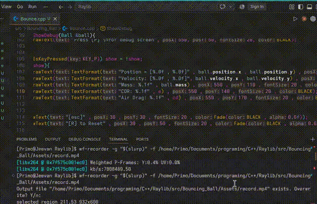
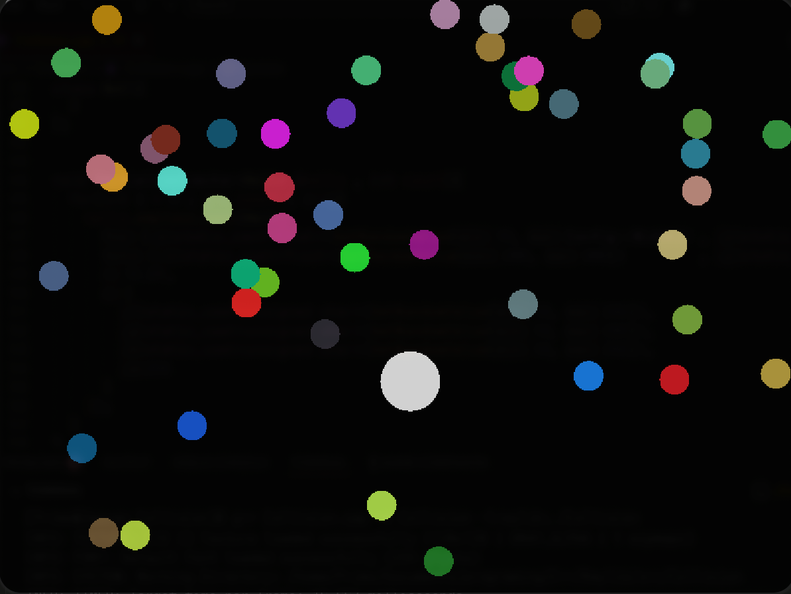
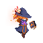

# Learning Graphics Programming

A collection of small C++ experiments built with [Raylib](https://www.raylib.com/). The repository focuses on learning graphics through implementation: motion, vectors, collision detection, 3D positioning, and sprite animation.

## Experiments

### Bouncing Ball

A physics experiment covering gravity, velocity, air resistance, and the coefficient of restitution.



Source: [Bounce.cpp](src/Bouncing_Ball/Bounce.cpp) · [Experiment notes](src/Bouncing_Ball/README.md)

### 3D Orbital Motion

A simple 3D scene that uses trigonometry to move an Earth sphere around a stationary Sun. A free camera allows the scene to be explored from different angles.

Source: [Rotation.cpp](src/Rotating_2D_Ball/Rotation.cpp) · [Experiment notes](src/Rotating_2D_Ball/README.md)

### Collision and Player Control

A small Raylib program exploring keyboard-based movement and collision detection.



Source: [Collision.cpp](src/Collision/Collision.cpp) · [Experiment notes](src/Collision/README.md)

### Sprite Animation

A frame-based animation experiment that loads an idle sprite sequence and advances through frames over time.



Source: [animation.cpp](src/Animation/animation.cpp) · [Asset credits](src/Animation/README.md)

## Concepts Explored

- Vector mathematics and trigonometric motion.
- Basic physics simulation and collision response.
- 2D movement and 3D positioning.
- Camera movement and real-time rendering.
- Sprite-sheet and frame-based animation.

## Repository Structure

```text
Learn_Graphics_Programming/
└── src/
    ├── Animation/
    │   ├── Assets/
    │   ├── animation.cpp
    │   └── README.md
    ├── Bouncing_Ball/
    │   ├── Assets/
    │   ├── Bounce.cpp
    │   └── README.md
    ├── Collision/
    │   ├── Assets/
    │   ├── Collision.cpp
    │   └── README.md
    └── Rotating_2D_Ball/
        ├── Rotation.cpp
        └── README.md
```

## Build Requirements

- A C++ compiler.
- Raylib configured for your platform.
- Raygui headers for the orbital-motion experiment.

Each folder contains an independent program. Build and run one experiment at a time. This repository does not currently include a shared CMake or Make build configuration, so compiler and linker settings need to be configured for the local Raylib installation. Run each program from its corresponding directory when it loads assets through relative paths.

## Asset Credits

The sprite artwork used in the animation experiment belongs to its original creators. Attribution and source links are documented in [src/Animation/README.md](src/Animation/README.md).

---

This repository is a learning workspace. Experiments and implementations may change as graphics programming concepts are explored in more depth.
