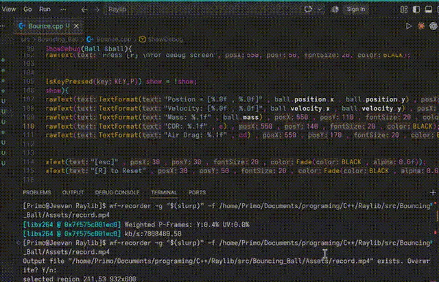

# Bouncing Ball Physics Simulation

A C++ and Raylib experiment that simulates a bouncing ball using a small set of classical mechanics concepts.

## Preview



## Concepts

### Gravity

Gravity applies a downward acceleration to the ball. In a simple simulation, the vertical velocity is updated over time:

```text
velocity_y += gravity * delta_time
position_y += velocity_y * delta_time
```

### Coefficient of Restitution

The coefficient of restitution describes how much relative speed remains after a collision along the collision normal.

For a simple ball bouncing against a stationary horizontal surface:

```text
restitution = speed_after_collision / speed_before_collision
```

- `e = 1`: perfectly elastic collision in the idealized model.
- `e = 0`: perfectly inelastic collision in the idealized model.
- `0 < e < 1`: some kinetic energy is lost during impact.

### Air Resistance

The simulation also explores drag as a force opposing motion. A simplified linear-drag model is proportional to velocity:

```text
F_drag = -c * velocity
```

This is a simplified model; real aerodynamic drag is generally dependent on air density, drag coefficient, reference area, and the square of speed.

## Controls

| Input | Action |
|---|---|
| P | Toggle debug screen |
| R | Reset statistics |
| Mouse click | Move the ball to the clicked position |
| Esc | Exit |

## Source

[View the implementation](Bounce.cpp)

## Build Requirements

- C++ compiler.
- Raylib configured for your platform.

This experiment does not currently include a dedicated CMake or Make build configuration. Configure Raylib's include and linker settings for your compiler, then build `Bounce.cpp`.

## Learning Notes

This experiment is intended to make motion and collision concepts visible through a real-time simulation. The equations above describe the concepts; the exact implementation should be read in the source file.
