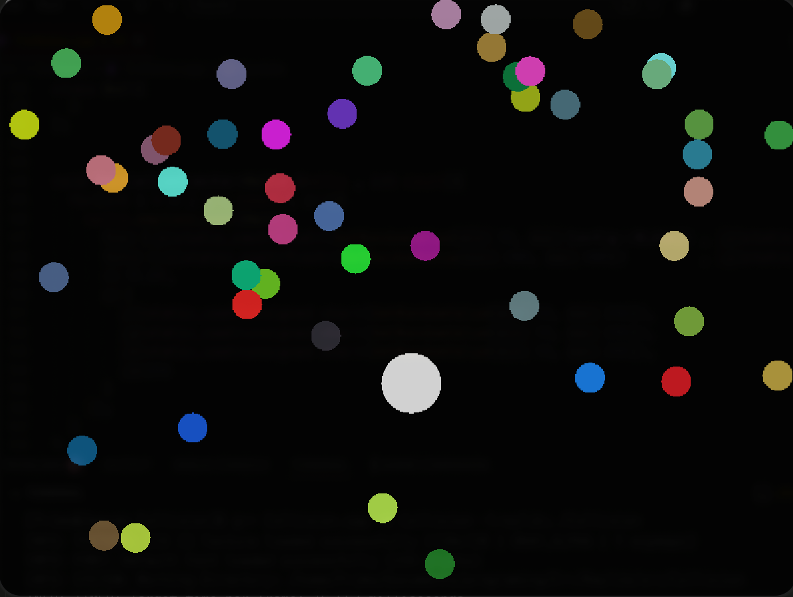

# Collision and Player Control

A small C++ and Raylib experiment exploring player movement, keyboard input, and collision detection.

## Preview

## Controls

| Action | Key |
|---|---|
| Move up | W |
| Move down | S |
| Move left | A |
| Move right | D |

## Concepts

- Reading keyboard input through Raylib.
- Updating a player's position in a real-time game loop.
- Checking collisions between the player and scene objects.
- Keeping movement and drawing logic organized.

## Source

[Collision.cpp](Collision.cpp)

## Build Requirements

A C++ compiler and a Raylib installation configured for your platform are required. This folder does not contain a standalone build script.
